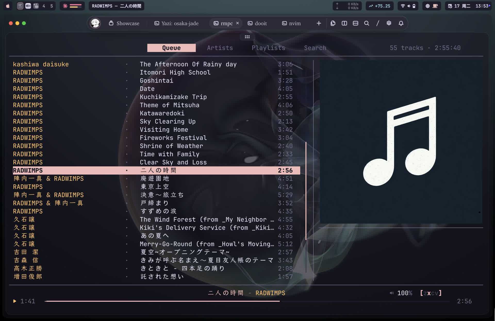
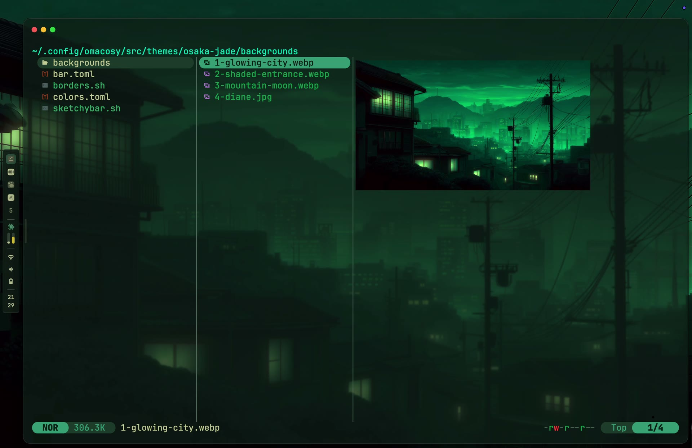
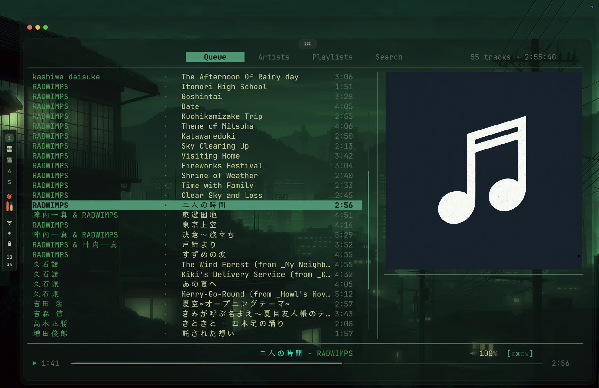
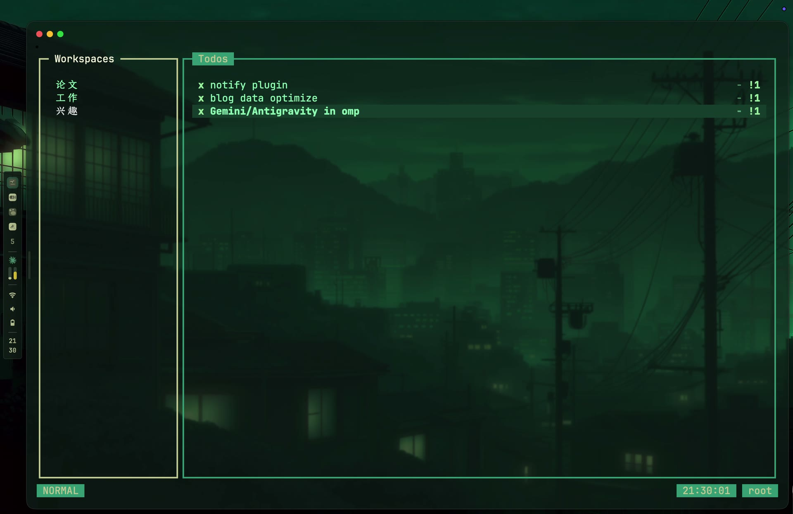
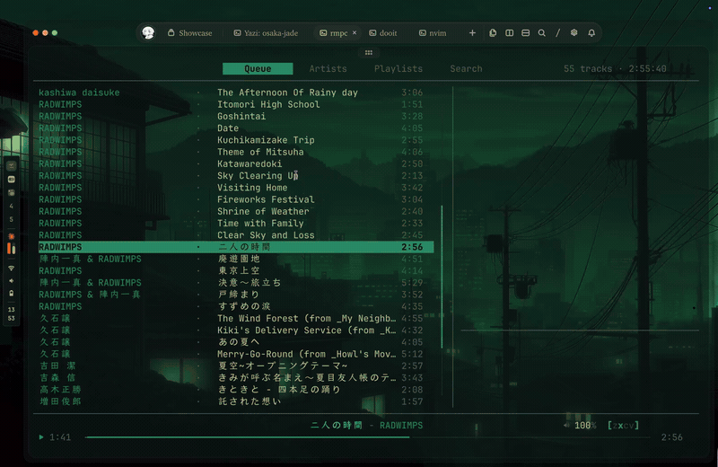

<div align="center">
  <h1>dotfiles</h1>
  <p><b>An omarchy-style macOS desktop with shared themes, keyboard navigation, tiling windows and terminal tools.</b></p>
  <p>English · <a href="README.zh-CN.md">中文</a></p>
  
  <a href="https://github.com/Asaki14/dotfiles/commits"></a>
  <a href="LICENSE"></a>
</div>


Built on [omacosy](https://github.com/paulsp94/omacosy), this setup brings window management, the status bar and everyday terminal tools under shared themes and shortcuts.

| Feature | In daily use |
|---|---|
| Shared appearance | Switch the wallpaper, bars and supported app palettes together |
| Keyboard navigation | Switch workspaces, move windows and jump straight to tools |
| Native status bar | Weather, AI quota, network speed, lyrics and fund estimates in one place |
| Terminal workspace | Use the editor, files, tasks and music separately or in split panes |

## Themes

Tern stays transparent and follows the desktop theme throughout the day.

<table>
  <tr>
    <td><b>Osaka Jade</b><br><a href="assets/themes/osaka-jade.jpg"></a></td>
    <td><b>Catppuccin</b><br><a href="assets/themes/catppuccin.jpg"></a></td>
  </tr>
  <tr>
    <td><b>Gruvbox</b><br><a href="assets/themes/gruvbox.jpg"></a></td>
    <td><b>Tokyo Night</b><br><a href="assets/themes/tokyo-night.jpg"></a></td>
  </tr>
  <tr>
    <td colspan="2" align="center"><b>Rosé Pine</b><br><a href="assets/themes/rose-pine.jpg"></a></td>
  </tr>
</table>

Use `theme-set <name>` to switch the wallpaper, bars and supported app palettes.

## Terminal tools

| Tool | Preview |
|---|---|
| **yazi**: file browsing and previews | [](assets/tools/yazi.jpg) |
| **rmpc**: local music playback and queue management | [](assets/layouts/single.jpg) |
| **dooit**: workspaces and task management | [](assets/tools/dooit.jpg) |

The dooit screenshots use demonstration tasks.

## Layouts

Pane layouts within a Tern window.

<table>
  <tr>
    <td><b>Single pane: music</b><br><a href="assets/layouts/single.jpg"></a></td>
    <td><b>Side by side: editor + files</b><br><a href="assets/layouts/columns.jpg"></a></td>
  </tr>
  <tr>
    <td><b>Stacked: editor above files</b><br><a href="assets/layouts/stacked.jpg"></a></td>
    <td><b>Three panes: editor + tasks + files</b><br><a href="assets/layouts/three-pane.jpg"></a></td>
  </tr>
</table>

<details>
<summary>Demo</summary>



[Watch the recording (MP4)](assets/desktop-demo.mp4)

</details>

## Everyday use

AeroSpace manages desktop windows by default, with one or more apps per workspace. The split layouts in the screenshots are panes inside Tern, not a required desktop layout.

In Tern, you can manually create two sessions to group your tabs:

| Session name | Contents | Return to it |
|---|---|---|
| `Agent` | Tabs running omp | `Super+Shift+A` restores the last tab and focus without creating a session |
| `Tools` | Separate tabs for rmpc, yazi and dooit | Each tool has its own global shortcut |

Start the tools, then use the shortcuts below to jump back. The music, file and task shortcuts find an existing tab or create one running the tool if none exists.

### Common shortcuts

`Super` means holding Caps Lock, which sends `Cmd+Ctrl+Option`, not Cmd alone. These shortcuts describe the default AeroSpace setup.

| Shortcut | Action |
|---|---|
| `Super+Enter` / `Super+Shift+Enter` | Focus the terminal, launching it if needed / open the default browser |
| `Super+Shift+A` | Return to Tern's `Agent` session |
| `Super+Shift+S` | Music: rmpc |
| `Super+Shift+Y` | Files: yazi |
| `Super+Shift+D` | Tasks: dooit |
| `Super+Shift+L` | Notes: Logseq |
| `Super+Shift+T` / `Super+Shift+B` | Next theme / next wallpaper |
| `Super+Shift+Q` | Lock the screen |
| `Super+K` | Show the shortcut cheatsheet |

| Shortcut | Windows and workspaces |
|---|---|
| `Super+1` through `Super+9` | Switch workspaces on the current display |
| `Super+Tab` / `Super+Shift+Tab` | Next / previous workspace |
| `Super+Arrow` | Focus the window in that direction |
| `Super+Shift+Arrow` | Move the window |
| `Super+Shift+1` through `Super+Shift+9` | Move the window to that workspace and follow it |
| `Super+F` | Enlarge the window within its workspace, keeping the bar and outer gaps |
| `Super+W` | Close the window |

See [omacosy's keybindings](omacosy/src/README.md#keybindings--super--hold-caps-lock) for the full list and OmniWM differences.

## Install on your Mac

The desktop was developed for macOS 26 Tahoe; compatibility with older macOS releases is not guaranteed. Install [Homebrew](https://brew.sh) and Xcode Command Line Tools (`xcode-select --install`) first.

The screenshots use [Tern](https://stencil.so/tern), which is currently in closed beta and is not installed by this setup. Ghostty is the default terminal. You can install the desktop without Tern, but its appearance and session workflow will differ from the screenshots.

**Installation changes macOS defaults, loads LaunchAgents, compiles helpers, sets the wallpaper and replaces configuration files.** Replaced files go to `~/.dotfiles-backup/<time>/`; file backups do not undo system settings. See the [omacosy installation guide](omacosy/src/README.md) for permissions and removal.

### 1. Download and preview

Do not overwrite an existing `~/.config`. The installer links the selected configuration directories into it.

```bash
git clone https://github.com/Asaki14/dotfiles.git ~/.local/share/dotfiles
cd ~/.local/share/dotfiles
./install.sh --dry-run
```

If you already have Tern installed, select it before installing the desktop:

```bash
printf 'TERMINAL=Tern\n' > omacosy/src/config/apps.local.conf
```

This file is gitignored. You can override other default apps here too; see the fields in [apps.conf](omacosy/src/config/apps.conf).

### 2. Install

```bash
./install.sh
```

By default, this installs the AeroSpace desktop and the packages and configurations for all repository modules, including optional tools not covered on this page. An existing installation keeps its chosen window manager.

| Option | Effect |
|---|---|
| `--modules omacosy,karabiner,fish,yazi` | Install only the listed modules and dependencies; the desktop runs only when `omacosy` is listed |
| `--no-desktop` | Install tool configurations without running the desktop installer |
| `--no-brew` | Skip the top-level `Brewfile`, not the desktop installer's own dependencies |
| `--no-network` | Skip the install-time IP city lookup, not later network access such as weather |
| `--dry-run` | Print installation actions without changing files |

### 3. Grant permissions and set up your tools

Follow the installation prompts in System Settings → Privacy & Security:

| Permission | Purpose |
|---|---|
| Accessibility | AeroSpace and desktop helpers manage windows |
| Input Monitoring | Karabiner provides the Super key; the gesture helper reads the trackpad |
| Bluetooth, Location, Automation | Bar device information, Wi-Fi names and system actions, as needed |

If Caps Lock does nothing, enable **Modify events** for your keyboard in Karabiner-Elements → Settings → Devices. See [omacosy's permissions guide](omacosy/src/README.md#permissions) for the complete list.

| Optional setup | Location or action |
|---|---|
| AI sessions and quota | Install and log in to [omp](https://github.com/can1357/oh-my-pi), then create an `Agent` session |
| Tasks | Install [dooit](https://github.com/kraanzu/dooit) separately; it is not included in the installer |
| Local music | Adjust `~/Music/lib` in `mpd/mpd.conf` and `beets/config.yaml`, start MPD, then run rmpc |
| Media keys and Now Playing | Run `sh ~/.config/mpd/nowplaying/install.sh` |
| Bar contents | Edit `omacosy/bar-items.conf` to remove unwanted data items |
| Machine-specific data | Headphones and city are detected; fill in `omacosy/scripts/fission_fund_wallet.json` for fund holdings |

Machine-specific data files are gitignored. Put API keys in the ignored `fish/conf.d/api_keys.local.fish`, not in public configuration.

## Configuration locations

| Path | Contents |
|---|---|
| [`omacosy/src/`](omacosy/src/) | Desktop source, themes, shortcuts and installer |
| [`omacosy/bar-items.conf`](omacosy/bar-items.conf) | Status bar layout |
| [`omacosy/scripts/`](omacosy/scripts/) | Weather, AI quota, lyrics and fund estimates |
| `fish/`, `nvim/`, `yazi/`, `btop/` | Shell, editor, file manager and system monitor |
| `mpd/`, `rmpc/`, `beets/` | Local music and library |
| `karabiner/`, `linearmouse/` | Keyboard and mouse |

Licensed under [MIT](LICENSE). omacosy's license is in [omacosy/src/LICENSE](omacosy/src/LICENSE).
