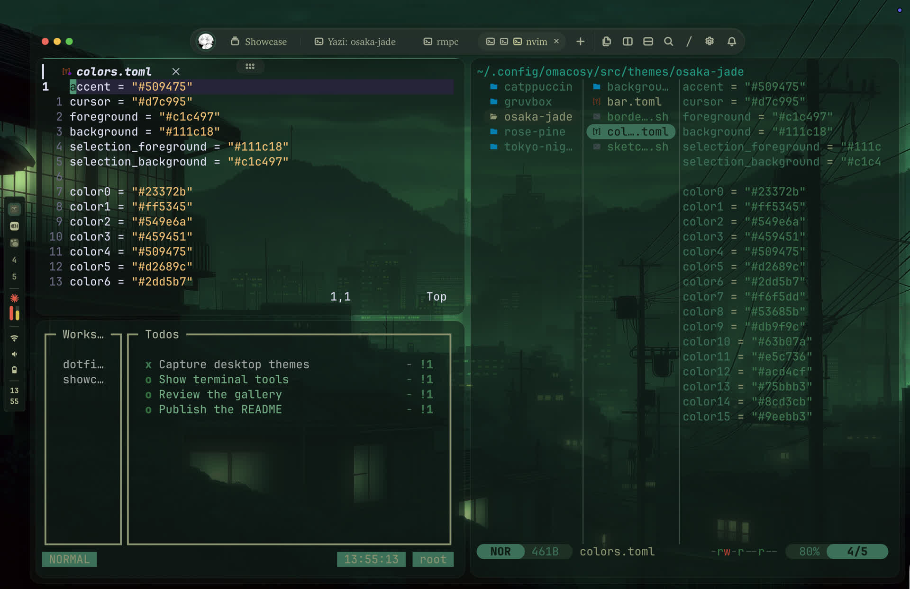
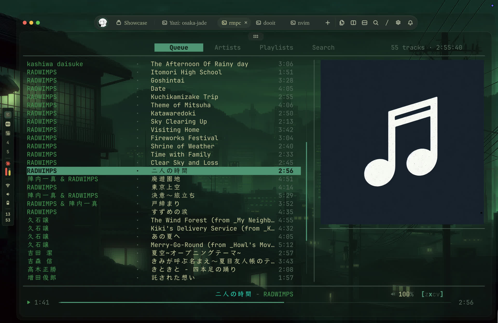
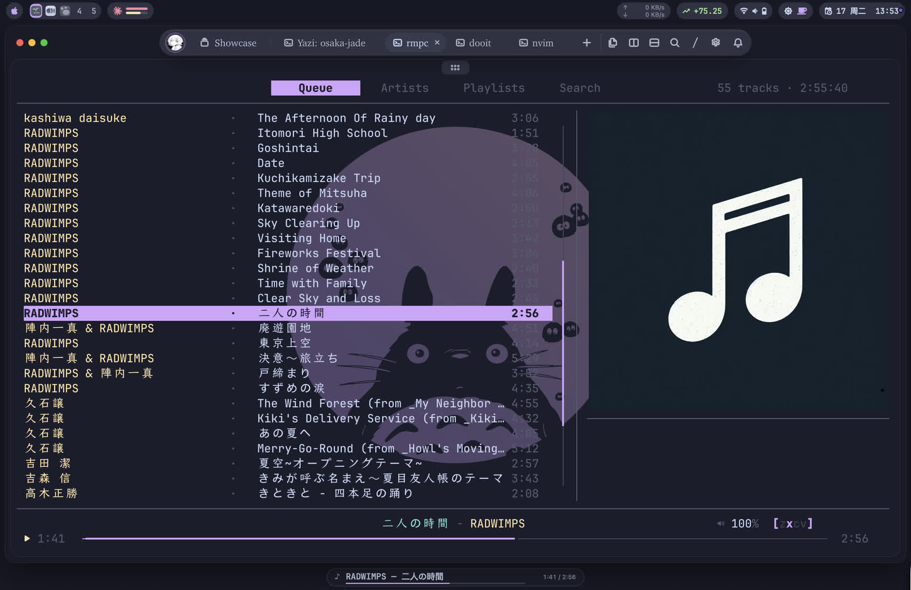
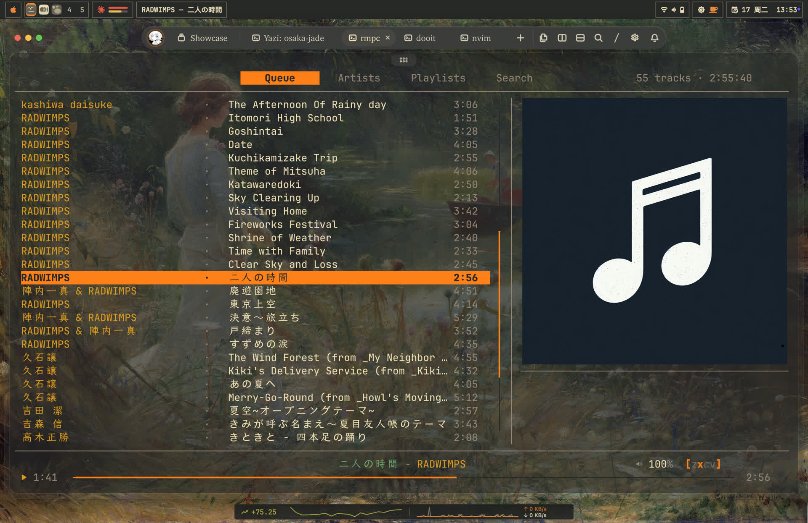
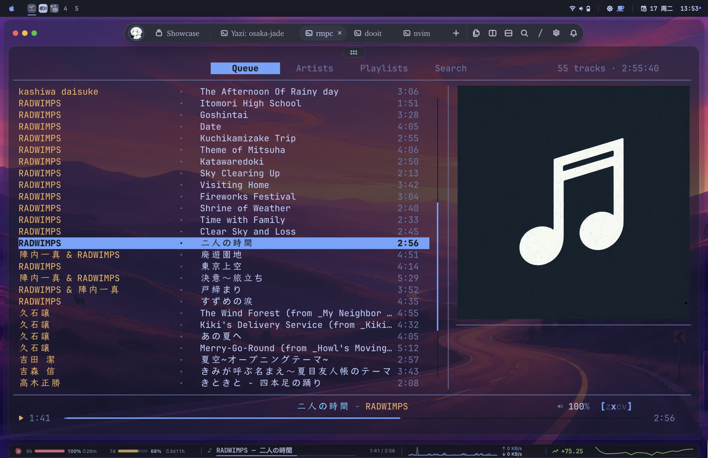
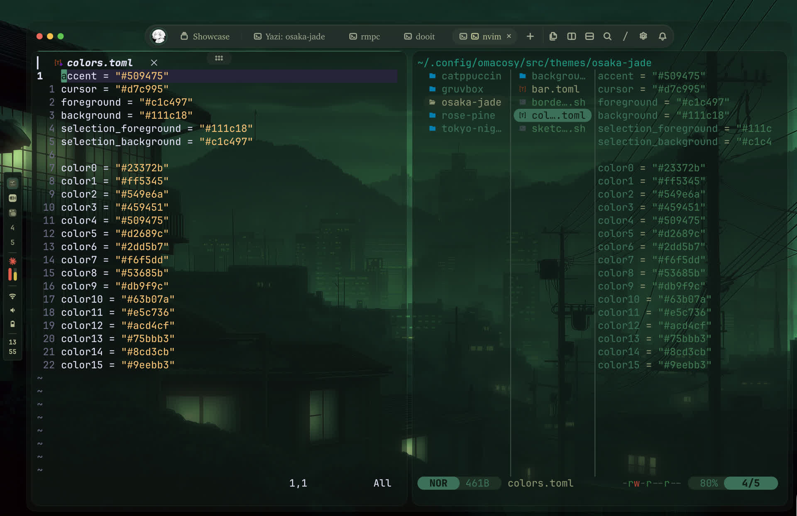
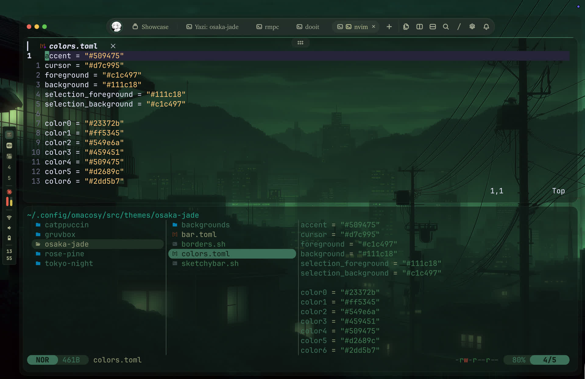

<div align="center">
  <h1>dotfiles</h1>
  <p><b>macOS dotfiles for an omarchy-style tiling desktop, terminal tools, local music and a self-hosted news reader.</b></p>
  <p>English · <a href="README.zh-CN.md">中文</a></p>
  
  <a href="https://github.com/Asaki14/dotfiles/commits"></a>
  <a href="LICENSE"></a>
</div>



## Night themes

Tern uses a transparent appearance from 19:30 to 08:00 and a separately selected theme during the day.

<table>
  <tr>
    <td><b>Osaka Jade</b><br><a href="assets/themes/osaka-jade.jpg"></a></td>
    <td><b>Catppuccin</b><br><a href="assets/themes/catppuccin.jpg"></a></td>
  </tr>
  <tr>
    <td><b>Gruvbox</b><br><a href="assets/themes/gruvbox.jpg"></a></td>
    <td><b>Tokyo Night</b><br><a href="assets/themes/tokyo-night.jpg"></a></td>
  </tr>
  <tr>
    <td colspan="2" align="center"><b>Rosé Pine</b><br><a href="assets/themes/rose-pine.jpg"></a></td>
  </tr>
</table>

Use `theme-set <name>` to switch the wallpaper, bars and supported app palettes.

## Terminal tools

| Tool | Preview |
|---|---|
| **yazi**: file browsing and previews | [](assets/tools/yazi.jpg) |
| **rmpc**: local music playback and queue management | [](assets/layouts/single.jpg) |
| **dooit**: workspaces and task management | [](assets/tools/dooit.jpg) |

The dooit screenshots use demonstration tasks.

## Layouts

Pane layouts within a Tern window.

<table>
  <tr>
    <td><b>Single pane: music</b><br><a href="assets/layouts/single.jpg"></a></td>
    <td><b>Side by side: editor + files</b><br><a href="assets/layouts/columns.jpg"></a></td>
  </tr>
  <tr>
    <td><b>Stacked: editor above files</b><br><a href="assets/layouts/stacked.jpg"></a></td>
    <td><b>Three panes: editor + tasks + files</b><br><a href="assets/layouts/three-pane.jpg"></a></td>
  </tr>
</table>

<details>
<summary>Demo</summary>


[Watch the recording (MP4)](assets/desktop-demo.mp4)

</details>

## Features

- **Tiling desktop**: based on [omacosy](https://github.com/paulsp94/omacosy), with AeroSpace, a native status bar, borders, gestures and themes. Source and local changes are in `omacosy/src`
- **Status bar data**: weather, AI quota, synced lyrics, net speed and an intraday fund estimate
- **Local music**: beets keeps the library, MPD plays it, rmpc is the player, and a Swift bridge puts MPD on macOS Now Playing and the media keys
- **News reader**: FreshRSS in Docker with a reader extension that translates articles in the background
- **Terminal and editor**: fish, Neovim (lazy.nvim), yazi with plugins, btop
- **Input that follows the pane**: a Tern plugin switches the macOS input source per terminal pane
- **System actions**: lock, sleep, appearance and weather as [Tinycast](https://tinycast.dev) script commands

## Quick Start

```bash
git clone https://github.com/Asaki14/dotfiles.git ~/.config
cd ~/.config && ./install.sh
```

If `~/.config` already exists, clone anywhere else: `install.sh` then links each config directory into `~/.config` and moves what it replaces to `~/.dotfiles-backup/<time>/`.

| Option | Effect |
|---|---|
| `--modules yazi,fish` | Only these config directories and the packages they need; the desktop runs only when `omacosy` is listed |
| `--dry-run` | Print every action, change nothing |
| `--no-brew` | Skip the Homebrew packages in `Brewfile` |
| `--no-desktop` | Skip the omacosy desktop (window manager, bar, themes) |
| `--no-network` | Do not look up the city from the IP address |

`install.sh` writes machine-specific settings to these gitignored files:

| File | Detected from |
|---|---|
| `omacosy/bar-items.local.conf` | The paired AirPods or headphones, whose battery the bar shows |
| `omacosy/scripts/location.local.json` | The city of your IP address (ip-api.com), for the weather |
| `omacosy/scripts/fission_fund_wallet.json` | Copied from the example; list your fund codes and shares, or drop `fission-estimator` from `bar-items.conf` |

## Before installing

- [Tern](https://stencil.so/tern) is in closed beta; install it yourself. The AI quota and article translation use [omp](https://github.com/can1357/oh-my-pi), which you install and log in to yourself.
- FreshRSS and Tinycast are set up by hand: see [FreshRSS](#freshrss) and [Tinycast](#tinycast) below.
- The omacosy installer changes macOS defaults, loads LaunchAgents, compiles helpers, sets the wallpaper and overwrites desktop configuration. File backups do not undo system settings. Read [omacosy/src/README.md](omacosy/src/README.md) first, or pass `--no-desktop`.
- API keys go in `fish/conf.d/api_keys.local.fish`, which is gitignored.

## What's Inside

| Path | What it is |
|---|---|
| `omacosy/src/` | The desktop: bar, window manager config, themes and their installer. `UPSTREAM` records the upstream commit it is based on |
| `omacosy/` | Bar layout (`bar-items.conf`) and its data scripts: weather, AI usage, lyrics, fund estimate |
| `fish/` `nvim/` `yazi/` `btop/` | Shell, editor, file manager and system monitor |
| `mpd/` `rmpc/` `beets/` | Music library, playback, playlists and the Now Playing bridge |
| `freshrss/` | FreshRSS compose file, reader extension and translation worker |
| `tern/plugins/` `tinycast/scripts/` | Tern terminal plugin and Tinycast system commands |
| `karabiner/` `linearmouse/` | Keyboard and mouse |

Paths that differ per machine but are not detected: the music library (`~/Music/lib` in `mpd/mpd.conf` and `beets/config.yaml`) and the `omp` binary (`freshrss/reader-settings.json`).

## FreshRSS

A local FreshRSS (`127.0.0.1:8088`, feeds update at minutes 7 and 37) whose `LocalReader` extension shows foreign-language articles in Chinese, with `查看原文` for the original. `reader.py` translates them in the background through omp with the model in `reader-settings.json`, so article text goes to that provider. The Mac must be awake.

```sh
colima start
docker-compose -f ~/.config/freshrss/compose.yaml up -d
open http://localhost:8088/              # create the admin user; it becomes the default user
~/.config/freshrss/install-reader.sh     # LaunchAgent local.freshrss.reader, every 30 s
```

| Task | Command or place |
|---|---|
| Refresh feeds now | `docker exec --user www-data freshrss cli/actualize-user.php --user <user>` |
| Run the translator now | `launchctl kickstart gui/$(id -u)/local.freshrss.reader` |
| Translator log | `freshrss/reader-data/worker.log` |
| Back up | Docker volumes `freshrss_freshrss_data`, `freshrss_freshrss_extensions` and `freshrss/reader-data/`; `down -v` deletes the volumes |
| Other devices | `tailscale serve --bg --https=8443 http://127.0.0.1:8088` |

Tests: `cd freshrss && uv run --with beautifulsoup4 --with lxml_html_clean --with markdown --with markdownify --with readability-lxml python -m unittest -v test_reader`

## Tinycast

Import once per machine: Tinycast Settings → Commands → enable custom commands → Import → choose `~/.config/tinycast/scripts`. The imported commands run the scripts in place, so keep the directory. Turn on "Show output" for Weather; it runs on demand.

| Command | Does | First-run permission |
|---|---|---|
| Toggle Appearance | Switches dark / light | Automation → System Events |
| Weather | Current weather for `omacosy/scripts/location.local.json` | none |
| Lock Screen | Sends ⌃⌘Q, which locks at once regardless of the screen-lock grace period | Accessibility |
| Sleep | `pmset sleepnow`, after a confirmation | none |

## Tern input source

`tern/plugins/input-source-policy` switches the macOS input source when focus moves between Tern panes: agent blocks get the last CJK source (Rime by default), panes titled `yazi`, `dooit` or `rmpc` and everything else get US Extended. A switch happens only when the focused pane or its class changes and has held for 700 ms, so a manual switch inside a pane sticks.

```sh
tern plugin link ~/.config/tern/plugins/input-source-policy   # install.sh runs this
tern/plugins/input-source-policy/scripts/input-source-policy status
```

The ASCII app list is `ASCII_APPS` in `window.luau`. Each switch is logged to `~/.local/state/tern-input-source-policy/policy.log`.

## Notes

- `AGENTS.md` describes how the pieces talk to each other.
- Licensed under [MIT](LICENSE). omacosy keeps its own license in `omacosy/src/LICENSE`.
