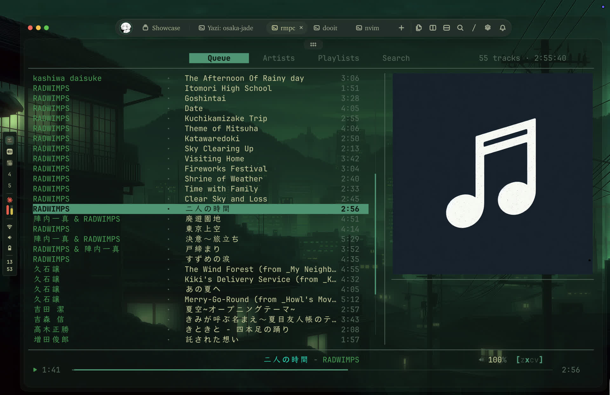

<div align="center">
  <h1>dotfiles</h1>
  <p><b>omarchy 风格的 macOS 桌面：统一配色、键盘操作、平铺窗口与终端工具。</b></p>
  <p><a href="README.md">English</a> · 中文</p>
  
  <a href="https://github.com/Asaki14/dotfiles/commits"></a>
  <a href="LICENSE"></a>
</div>


这套配置基于 [omacosy](https://github.com/paulsp94/omacosy)，把窗口管理、状态栏和常用终端工具放在同一套主题与快捷键下。

| 特点 | 日常体验 |
|---|---|
| 统一外观 | 一次切换壁纸、状态栏及支持的 App 配色 |
| 键盘操作 | 切工作区、移动窗口、跳转工具，不必逐个找窗口 |
| 原生状态栏 | 集中显示天气、AI 额度、网速、歌词和基金估值 |
| 终端工作区 | 编辑器、文件、待办和音乐可单独使用，也可组合窗格 |

## 主题

Tern 全天使用透明外观，配色随桌面主题切换。

<table>
  <tr>
    <td><b>Osaka Jade</b><br><a href="assets/themes/osaka-jade.jpg"></a></td>
    <td><b>Catppuccin</b><br><a href="assets/themes/catppuccin.jpg"></a></td>
  </tr>
  <tr>
    <td><b>Gruvbox</b><br><a href="assets/themes/gruvbox.jpg"></a></td>
    <td><b>Tokyo Night</b><br><a href="assets/themes/tokyo-night.jpg"></a></td>
  </tr>
  <tr>
    <td colspan="2" align="center"><b>Rosé Pine</b><br><a href="assets/themes/rose-pine.jpg"></a></td>
  </tr>
</table>

用 `theme-set <主题名>` 切换壁纸、状态栏及支持的 App 配色。

## 终端工具

| 工具 | 界面 |
|---|---|
| **yazi**：文件浏览与预览 | [](assets/tools/yazi.jpg) |
| **rmpc**：本地音乐播放与队列管理 | [](assets/layouts/single.jpg) |
| **dooit**：工作区与待办管理 | [](assets/tools/dooit.jpg) |

dooit 图中使用演示待办。

## 布局

Tern 窗口内的窗格布局。

<table>
  <tr>
    <td><b>单窗格：音乐库</b><br><a href="assets/layouts/single.jpg"></a></td>
    <td><b>左右双栏：编辑器与文件</b><br><a href="assets/layouts/columns.jpg"></a></td>
  </tr>
  <tr>
    <td><b>上下排列：编辑器与文件</b><br><a href="assets/layouts/stacked.jpg"></a></td>
    <td><b>三窗格：编辑器、待办与文件</b><br><a href="assets/layouts/three-pane.jpg"></a></td>
  </tr>
</table>

<details>
<summary>操作演示</summary>


[观看录屏（MP4）](assets/desktop-demo.mp4)

</details>

## 日常使用

桌面默认用 AeroSpace 管理窗口，每个工作区可以放一个或多个 App。截图中的分栏是 Tern 内部的窗格，不是必须使用的桌面布局。

在 Tern 中可以手动建立两个 session（会话，用来归组标签页）：

| session 名称 | 放什么 | 如何返回 |
|---|---|---|
| `Agent` | 运行 omp 的标签页 | `Super+Shift+A` 恢复上次的标签和焦点，不新建会话 |
| `Tools` | 分别运行 rmpc、yazi、dooit 的标签页 | 用各工具的全局快捷键直达 |

先启动工具，再使用下表跳转。音乐、文件和待办的快捷键会查找已有标签，找不到时才新建并运行工具。

### 常用快捷键

`Super` 是按住 Caps Lock，等同于 `Cmd+Ctrl+Option`，不是单独的 Cmd。下面以默认 AeroSpace 配置为准。

| 快捷键 | 操作 |
|---|---|
| `Super+Enter` / `Super+Shift+Enter` | 聚焦终端，未打开则启动 / 打开默认浏览器 |
| `Super+Shift+A` | 返回 Tern 的 `Agent` 会话 |
| `Super+Shift+S` | 音乐：rmpc |
| `Super+Shift+Y` | 文件：yazi |
| `Super+Shift+D` | 待办：dooit |
| `Super+Shift+L` | 笔记：Logseq |
| `Super+Shift+T` / `Super+Shift+B` | 下一套主题 / 下一张壁纸 |
| `Super+Shift+Q` | 锁屏 |
| `Super+K` | 查看快捷键速查表 |

| 快捷键 | 窗口与工作区 |
|---|---|
| `Super+1` 至 `Super+9` | 切换当前显示器的工作区 |
| `Super+Tab` / `Super+Shift+Tab` | 下一个 / 上一个工作区 |
| `Super+方向键` | 聚焦对应方向的窗口 |
| `Super+Shift+方向键` | 移动窗口 |
| `Super+Shift+1` 至 `Super+Shift+9` | 把窗口移到对应工作区并跟随 |
| `Super+F` | 在当前工作区放大窗口，保留状态栏和外边距 |
| `Super+W` | 关闭窗口 |

完整按键和 OmniWM 的差异见 [omacosy 快捷键说明](omacosy/src/README.md#keybindings--super--hold-caps-lock)。

## 安装到自己的 Mac

桌面以 macOS 26 Tahoe 为开发基线，不保证旧版 macOS 的兼容性。先安装 [Homebrew](https://brew.sh) 和 Xcode Command Line Tools（`xcode-select --install`）。

截图使用 [Tern](https://stencil.so/tern)，它目前处于封闭内测，安装器不会安装它。默认终端是 Ghostty，不依赖 Tern 也能安装桌面，但外观和会话操作不会与截图完全相同。

**安装会修改 macOS defaults、加载 LaunchAgents、编译辅助程序、设置壁纸并替换配置文件。** 被替换的文件保存在 `~/.dotfiles-backup/<时间>/`，文件备份不能还原系统设置。权限和卸载方式见 [omacosy 安装说明](omacosy/src/README.md)。

### 1. 下载并预览改动

不要覆盖现有的 `~/.config`，安装器会把所选配置目录链接进去。

```bash
git clone https://github.com/Asaki14/dotfiles.git ~/.local/share/dotfiles
cd ~/.local/share/dotfiles
./install.sh --dry-run
```

如果已经安装 Tern，安装前把桌面终端改成 Tern：

```bash
printf 'TERMINAL=Tern\n' > omacosy/src/config/apps.local.conf
```

该文件不纳入 Git。其他默认 App 也可在这里覆盖，字段见 [apps.conf](omacosy/src/config/apps.conf)。

### 2. 安装

```bash
./install.sh
```

默认安装 AeroSpace 桌面和仓库各模块的软件及配置，包括不在首页展开的可选工具。已有安装会保留所选窗口管理器。

| 选项 | 作用 |
|---|---|
| `--modules omacosy,karabiner,fish,yazi` | 只安装列出的模块及依赖，包含 `omacosy` 才安装桌面 |
| `--no-desktop` | 只安装工具配置，不运行桌面安装器 |
| `--no-brew` | 跳过顶层 `Brewfile`，不跳过桌面安装器自己的依赖安装 |
| `--no-network` | 跳过安装时的 IP 城市查询，不禁用天气等后续联网 |
| `--dry-run` | 打印安装动作，不修改文件 |

### 3. 授权并配置自己的工具

在「系统设置 → 隐私与安全性」中按安装提示授权：

| 权限 | 用途 |
|---|---|
| 辅助功能 | AeroSpace 及桌面辅助程序管理窗口 |
| 输入监控 | Karabiner 提供 Super 键，手势程序读取触控板 |
| 蓝牙、定位、自动化 | 状态栏设备信息、Wi-Fi 名称和系统操作，按需开启 |

如果 Caps Lock 没有效果，在 Karabiner-Elements → Settings → Devices 中为键盘启用 **Modify events**。完整权限清单见 [omacosy 权限说明](omacosy/src/README.md#permissions)。

| 按需配置 | 位置或操作 |
|---|---|
| AI 会话与额度 | 自行安装并登录 [omp](https://github.com/can1357/oh-my-pi)，再建立 `Agent` 会话 |
| 待办 | 自行安装 [dooit](https://github.com/kraanzu/dooit)，安装器未包含它 |
| 本地音乐 | 修改 `mpd/mpd.conf` 和 `beets/config.yaml` 中的 `~/Music/lib`，启动 MPD 后运行 rmpc |
| 媒体键与「正在播放」 | 执行 `sh ~/.config/mpd/nowplaying/install.sh` |
| 状态栏内容 | 编辑 `omacosy/bar-items.conf`，删除不需要的数据项 |
| 本机数据 | 耳机与城市自动写入本机配置，基金填写 `omacosy/scripts/fission_fund_wallet.json` |

本机数据文件不纳入 Git。API key 放在已忽略的 `fish/conf.d/api_keys.local.fish`，不要写入公开配置。

## 配置位置

| 路径 | 内容 |
|---|---|
| [`omacosy/src/`](omacosy/src/) | 桌面本体、主题、快捷键及安装器 |
| [`omacosy/bar-items.conf`](omacosy/bar-items.conf) | 状态栏布局 |
| [`omacosy/scripts/`](omacosy/scripts/) | 天气、AI 额度、歌词及基金估值 |
| `fish/`、`nvim/`、`yazi/`、`btop/` | Shell、编辑器、文件管理器和系统监视器 |
| `mpd/`、`rmpc/`、`beets/` | 本地音乐与曲库 |
| `karabiner/`、`linearmouse/` | 键盘和鼠标 |

以 [MIT](LICENSE) 许可发布。omacosy 的许可见 [omacosy/src/LICENSE](omacosy/src/LICENSE)。
