<div align="center">
  <h1>dotfiles</h1>
  <p><b>一套 macOS <code>~/.config</code>：omarchy 风格的平铺桌面、本地音乐库和自托管新闻阅读器，一个 <code>install.sh</code> 装好。</b></p>
  <p><a href="README.md">English</a> · 中文</p>
  
  <a href="https://github.com/Asaki14/dotfiles/commits"></a>
  <a href="LICENSE"></a>
</div>

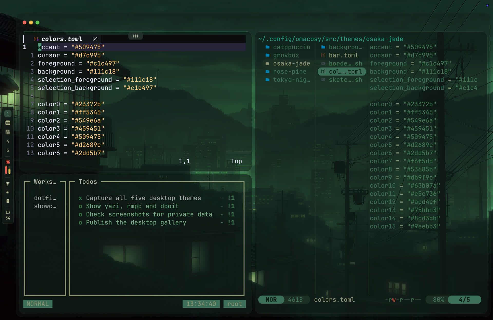

## 夜间主题

5 套桌面主题均使用 Tern 在 19:30 至次日 08:00 启用的透明外观。拍摄保留日常使用的窗口尺寸和字号。

<table>
  <tr>
    <td><b>Osaka Jade</b><br><a href="assets/themes/osaka-jade.jpg"></a></td>
    <td><b>Catppuccin</b><br><a href="assets/themes/catppuccin.jpg">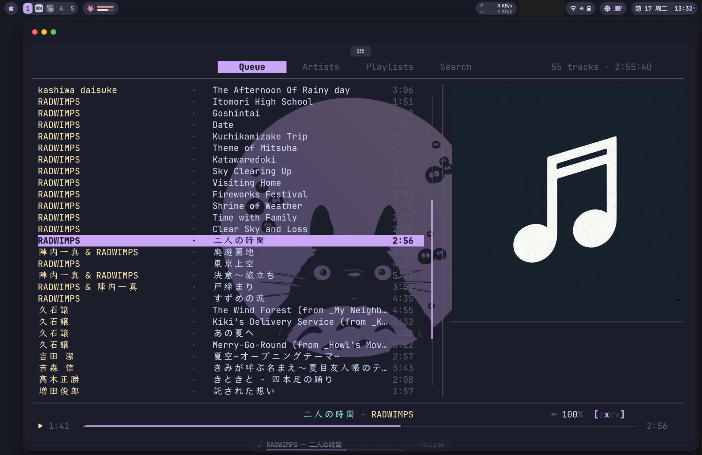</a></td>
  </tr>
  <tr>
    <td><b>Gruvbox</b><br><a href="assets/themes/gruvbox.jpg">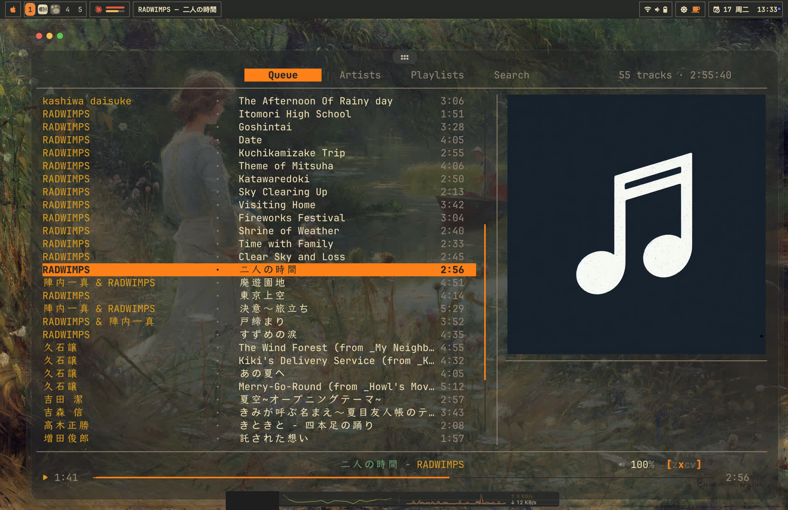</a></td>
    <td><b>Tokyo Night</b><br><a href="assets/themes/tokyo-night.jpg">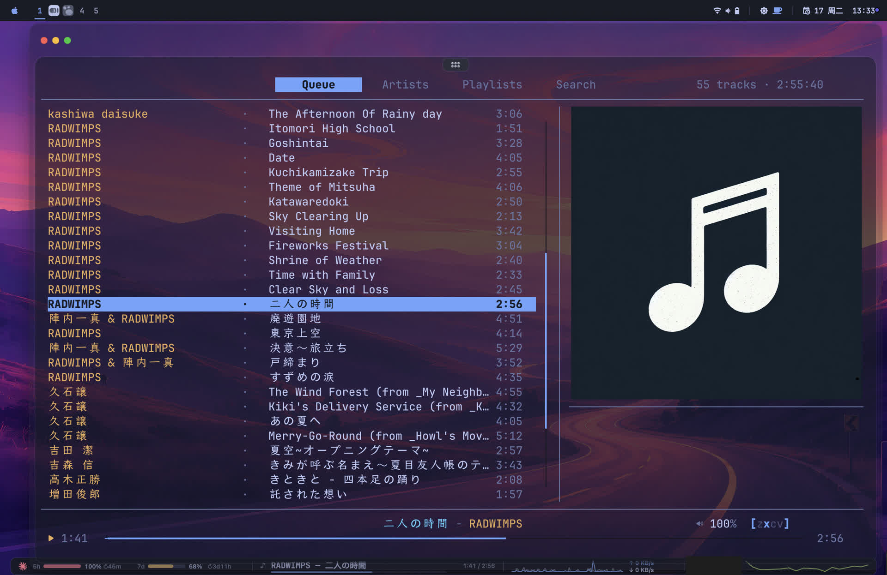</a></td>
  </tr>
  <tr>
    <td colspan="2" align="center"><b>Rosé Pine</b><br><a href="assets/themes/rose-pine.jpg">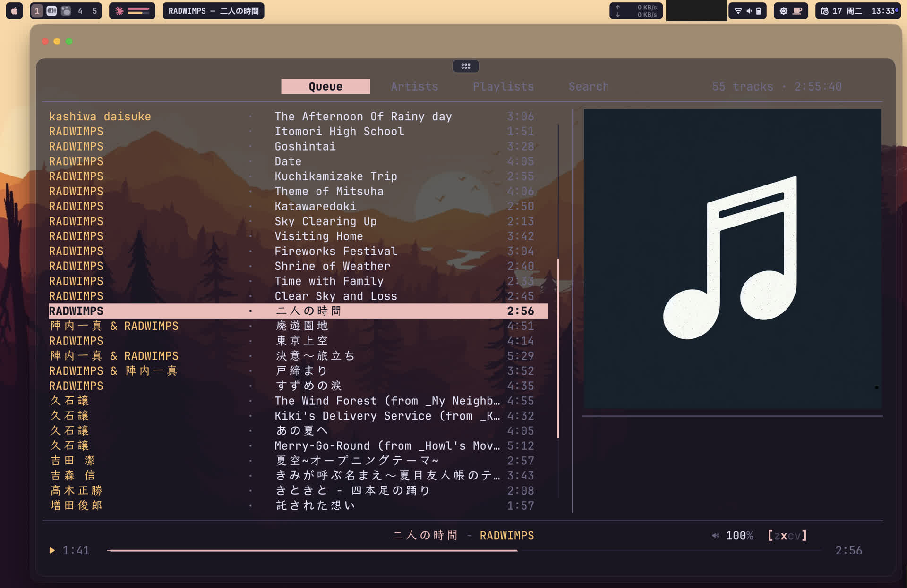</a></td>
  </tr>
</table>

运行 `theme-set <主题名>`，联动切换壁纸、状态栏及支持的 App 配色。Tern 保留单独选择的日间主题。

## 终端工具

| 工具 | Tern 中的实际界面 |
|---|---|
| **yazi**：浏览文件、预览主题配置 | [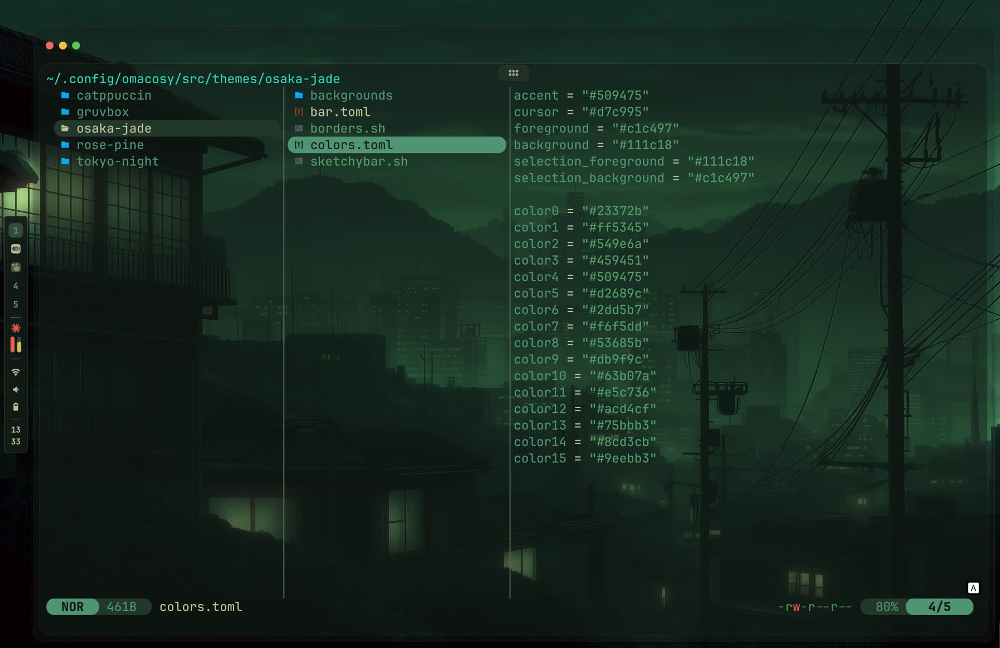](assets/tools/yazi.jpg) |
| **rmpc**：浏览本地音乐库与播放队列 | [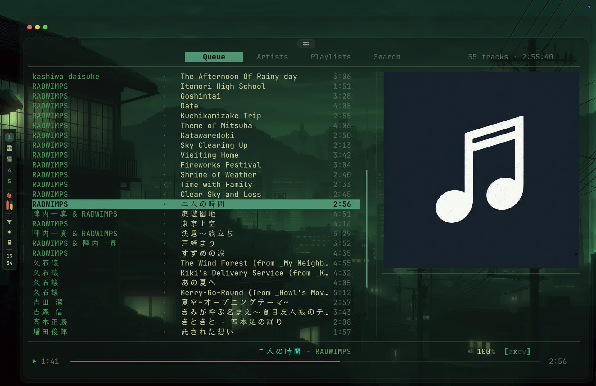](assets/layouts/single.jpg) |
| **dooit**：工作区、待办与完成状态 | [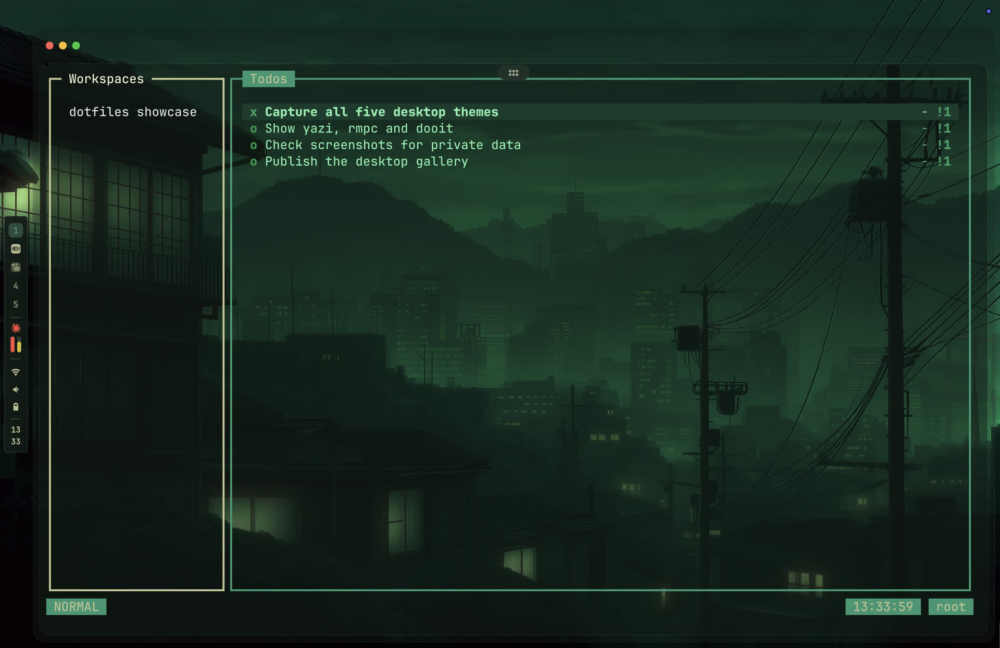](assets/tools/dooit.jpg) |

dooit 使用独立的演示数据库，不展示私人待办。

## 布局

以下是 AeroSpace 管理的窗口内的 Tern 窗格布局。点击图片可查看大图。

<table>
  <tr>
    <td><b>单窗格：音乐库</b><br><a href="assets/layouts/single.jpg"></a></td>
    <td><b>左右双栏：编辑器与文件</b><br><a href="assets/layouts/columns.jpg">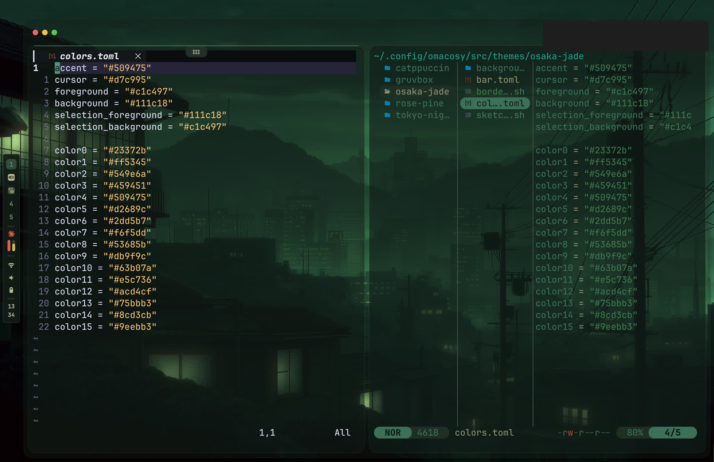</a></td>
  </tr>
  <tr>
    <td><b>上下排列：编辑器与文件</b><br><a href="assets/layouts/stacked.jpg">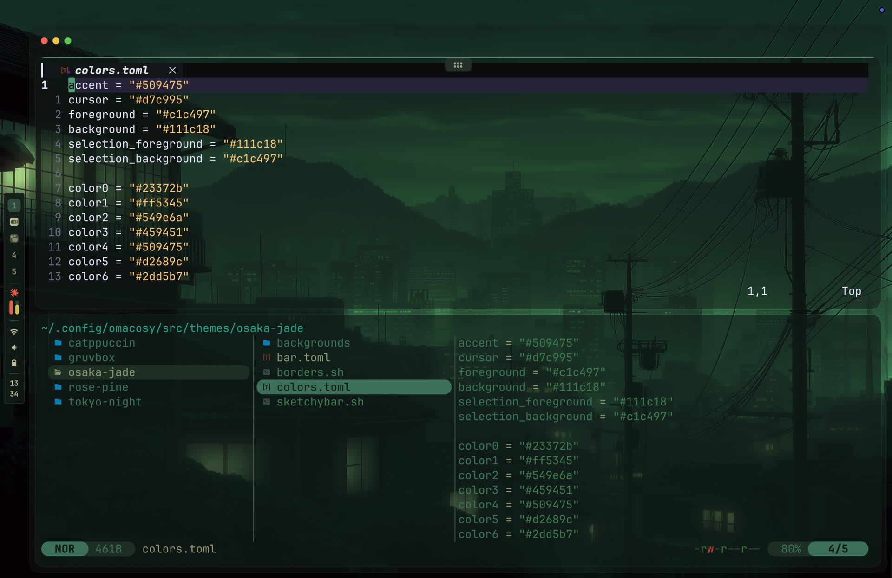</a></td>
    <td><b>三窗格：编辑器、待办与文件</b><br><a href="assets/layouts/three-pane.jpg"></a></td>
  </tr>
</table>

<details>
<summary>观看主题、终端工具与布局操作实录</summary>

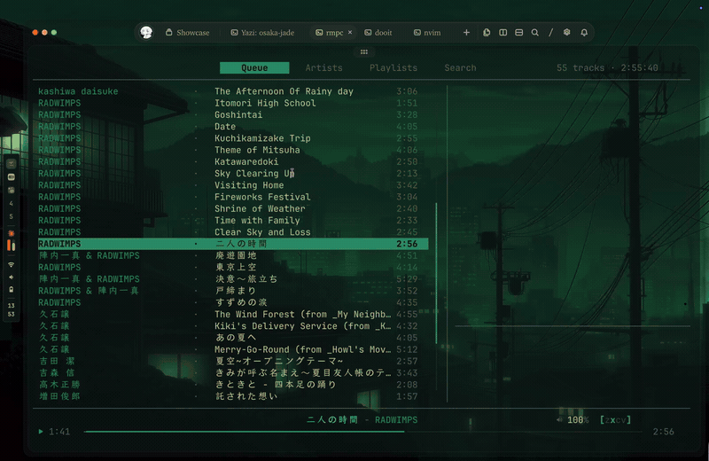

[观看 59 秒录屏（MP4）](assets/desktop-demo.mp4)

</details>

全部来自这台 Mac 正在运行的桌面，不是效果图。私人通知和基金数据已遮挡，录屏不含音频。

## 功能

- **平铺桌面**：[omacosy](https://github.com/paulsp94/omacosy)（AeroSpace、原生状态栏、窗口边框、手势、主题）连同本配置的改动一起放在 `omacosy/src`
- **状态栏数据**：天气、AI 额度、同步歌词、网速和基金盘中估值
- **本地音乐**：beets 管理曲库，MPD 播放，rmpc 作播放器；Swift 桥接程序把 MPD 接入 macOS「正在播放」和媒体键
- **新闻阅读**：Docker 里的 FreshRSS，阅读扩展在后台翻译外文文章
- **终端与编辑器**：fish、Neovim（lazy.nvim）、带插件的 yazi、btop
- **输入法跟随窗格**：Tern 插件按终端窗格切换 macOS 输入法
- **系统操作**：锁屏、睡眠、切换外观和天气，做成 [Tinycast](https://tinycast.dev) 脚本命令

## 快速开始

```bash
git clone https://github.com/Asaki14/dotfiles.git ~/.config
cd ~/.config && ./install.sh
```

如果 `~/.config` 已存在，克隆到其他目录即可：`install.sh` 会把各配置目录链接进 `~/.config`，被替换的文件移到 `~/.dotfiles-backup/<时间>/`。

| 选项 | 作用 |
|---|---|
| `--modules yazi,fish` | 只装这些配置目录及其所需软件；列出 `omacosy` 时才装桌面 |
| `--dry-run` | 只打印每一步，不做改动 |
| `--no-brew` | 跳过 `Brewfile` 里的 Homebrew 软件 |
| `--no-desktop` | 跳过 omacosy 桌面（窗口管理、状态栏、主题） |
| `--no-network` | 不按 IP 地址查询所在城市 |

`install.sh` 把本机的值写进 gitignore 的文件，仓库本身不含任何个人值：

| 文件 | 来源 |
|---|---|
| `omacosy/bar-items.local.conf` | 已配对的 AirPods 或耳机，状态栏显示其电量 |
| `omacosy/scripts/location.local.json` | IP 地址所在城市（ip-api.com），用于天气 |
| `omacosy/scripts/fission_fund_wallet.json` | 从示例复制；填入基金代码和份额，或从 `bar-items.conf` 删掉 `fission-estimator` |

## 安装前须知

- [Tern](https://stencil.so/tern) 处于封闭内测，需自行安装。AI 额度和文章翻译依赖 [omp](https://github.com/can1357/oh-my-pi)，需自行安装并登录。
- FreshRSS 和 Tinycast 需手动设置，见下文 [FreshRSS](#freshrss) 和 [Tinycast](#tinycast)。
- omacosy 安装器会修改 macOS defaults、加载 LaunchAgents、编译辅助程序、设置壁纸，并覆盖桌面配置。文件备份不能还原这些系统设置。先读 [omacosy/src/README.md](omacosy/src/README.md)，或加 `--no-desktop`。
- API key 写入 `fish/conf.d/api_keys.local.fish`，该文件已被 gitignore。

## 目录

| 路径 | 内容 |
|---|---|
| `omacosy/src/` | 桌面本体：状态栏、窗口管理配置、主题及其安装器；`UPSTREAM` 记录所基于的上游提交 |
| `omacosy/` | 状态栏布局（`bar-items.conf`）及数据脚本：天气、AI 用量、歌词、基金估值 |
| `fish/` `nvim/` `yazi/` `btop/` | Shell、编辑器、文件管理器和系统监视器 |
| `mpd/` `rmpc/` `beets/` | 曲库、播放、歌单和「正在播放」桥接 |
| `freshrss/` | FreshRSS compose 文件、阅读扩展和翻译进程 |
| `tern/plugins/` `tinycast/scripts/` | Tern 终端插件和 Tinycast 系统命令 |
| `karabiner/` `linearmouse/` | 键盘和鼠标 |

因机器而异、但不会自动检测的路径：曲库（`mpd/mpd.conf` 和 `beets/config.yaml` 中的 `~/Music/lib`）和 `omp` 程序（`freshrss/reader-settings.json`）。

## FreshRSS

本机运行的 FreshRSS（`127.0.0.1:8088`，每小时第 7、37 分钟更新订阅）。`LocalReader` 扩展把外文文章显示为中文，点「查看原文」切回原文。`reader.py` 在后台通过 omp 调用 `reader-settings.json` 里的模型翻译，文章正文会发给该模型服务。Mac 需保持唤醒。

```sh
colima start
docker-compose -f ~/.config/freshrss/compose.yaml up -d
open http://localhost:8088/              # 创建管理员账户，它会成为默认用户
~/.config/freshrss/install-reader.sh     # 安装 LaunchAgent local.freshrss.reader，每 30 秒运行
```

| 操作 | 命令或位置 |
|---|---|
| 立即更新订阅 | `docker exec --user www-data freshrss cli/actualize-user.php --user <user>` |
| 立即运行翻译 | `launchctl kickstart gui/$(id -u)/local.freshrss.reader` |
| 翻译日志 | `freshrss/reader-data/worker.log` |
| 备份 | Docker 卷 `freshrss_freshrss_data`、`freshrss_freshrss_extensions` 和 `freshrss/reader-data/`；`down -v` 会删除这两个卷 |
| 其他设备访问 | `tailscale serve --bg --https=8443 http://127.0.0.1:8088` |

测试：`cd freshrss && uv run --with beautifulsoup4 --with lxml_html_clean --with markdown --with markdownify --with readability-lxml python -m unittest -v test_reader`

## Tinycast

每台机器导入一次：Tinycast 设置 → 命令 → 启用自定义命令 → 导入 → 选择 `~/.config/tinycast/scripts`。导入的命令直接运行该目录里的脚本，不要删除该目录。给 Weather 打开「显示输出」，天气需手动执行。

| 命令 | 作用 | 首次运行需要的权限 |
|---|---|---|
| Toggle Appearance | 切换深色 / 浅色 | 自动化 → 系统事件 |
| Weather | 查询 `omacosy/scripts/location.local.json` 所在地的实况天气 | 无 |
| Lock Screen | 发送 ⌃⌘Q，立即锁屏，不受锁屏宽限期影响 | 辅助功能 |
| Sleep | 确认后执行 `pmset sleepnow` | 无 |

## Tern 输入法

`tern/plugins/input-source-policy` 在 Tern 窗格间切换焦点时切换 macOS 输入法：Agent 窗格用上次的中文输入法（默认 Rime），标题为 `yazi`、`dooit`、`rmpc` 的窗格及其他窗格用 US Extended。只有焦点窗格或其类别变化并保持 700 ms 后才切换，在窗格内手动切换的输入法不会被改回。

```sh
tern plugin link ~/.config/tern/plugins/input-source-policy   # install.sh 会执行
tern/plugins/input-source-policy/scripts/input-source-policy status
```

英文应用名单是 `window.luau` 里的 `ASCII_APPS`。每次切换记录在 `~/.local/state/tern-input-source-policy/policy.log`。

## 说明

- `AGENTS.md` 说明各部分之间的数据流。
- 以 [MIT](LICENSE) 许可发布。omacosy 的许可见 `omacosy/src/LICENSE`。
