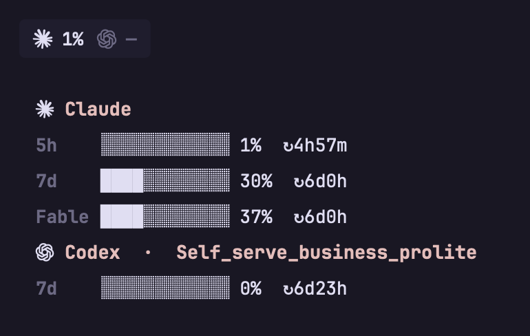
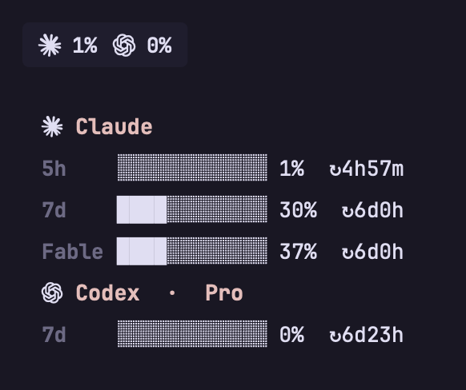

# Codex Pro 用量显示修复证据

2026-09-08 12:02（UTC+8），macOS 26.6.2（25G83）、CodexBar 0.56.4。
基线：`eb5f494007b073ec04b41b69748b83c9658fcf4d`。

## 实测输入与根因

按 `aiFetch` 的原参数执行，两家均退出 0：

```sh
/opt/homebrew/bin/codexbar usage --provider claude --format json --no-color --web-timeout 20
/opt/homebrew/bin/codexbar usage --provider codex --format json --no-color --web-timeout 20
```

完整响应（仅账号邮箱、重置额度 ID 脱敏，JSON 重新缩进）：
[Claude](../../test/fixtures/ai-usage/claude.json)、[Codex](../../test/fixtures/ai-usage/codex.json)。

| 项目 | Claude | Codex Pro |
|---|---|---|
| `usage.primary` | 300 分钟，已用 1% | `null` |
| `usage.secondary` | 10080 分钟，已用 30% | 10080 分钟，已用 0% |
| 其他窗口 | Fable 周额度，已用 37% | 无 |
| weekly 重置时间 | `2026-09-14T05:00:00Z` | `2026-09-15T04:01:17Z` |
| `loginMethod` | 未提供 | `self_serve_business_prolite` |
| 旧 `aiPrimary` 返回 | `(1, false)` | `nil`，pill 显示 `—` |
| 修复后返回 | `(1, false)` | `(0, false)`，pill 显示 `0%` |

**codexbar 的窗口数据正确，不需要修改或升级 codexbar。** bar 把 `primary` 当成必有的 5h 窗口，因此漏掉有效 weekly 数据；不是网络失败或 stale cache。

外部脚本的 popup 当时已跳过空 primary，只有一条 `7d`，没有复现行错位；实际问题是标题直接显示 `Self_serve_business_prolite`。其窗口标题仍写死为 5h/7d，不能用于推断后续订阅结构。

## 显示口径与兼容边界

- 保留原有**已用百分比**口径；`0%` 表示 weekly 已用 0%、余量 100%，不把一家的含义反转成剩余比例。
- Codex 按 primary → secondary → tertiary → extraRateWindows 选择首个有效窗口供 pill 使用；popup 展示所有有效窗口，普通窗口标题来自 `windowMinutes`，scoped 窗口保留来源标题，无固定两行上限。
- 当前 Pro 显示 `Codex · Pro` 和唯一 `7d` 行；不伪造 5h。普通 Plus 的 5h/7d 优先顺序不变。
- Claude 的脚本行、primary 取值、阈值和 stale 判定不变；缓存超过 900 秒仍 dim，缺失/损坏的 Codex 数据仍显示不可用而非零。
- 外部 `ai_usage_popup.sh` 无需更新；Codex 不再采纳其 `head2` / `x.*` 行。不开启 `ai-usage-script` 时仍不启动 AI 功能。

## pill / popup 对比

同一份脱敏响应和 Claude TSV，抽取基线及修复后的真实 `drawAIPill`、`PopupView`、行解析函数，以 AppKit `cacheDisplay` 离屏渲染；不是运行中桌面的截屏。未包含任何其他应用内容。

| 修复前（Rose Pine） | 修复后（Rose Pine） |
|---|---|
|  |  |

解析后的行：[修复前 TSV](before-rows.tsv)、[修复后 TSV](after-rows.tsv)。Claude 四行逐字段一致；popup 宽度由 356pt 降至 262pt，高度保持 172pt。

其余主题同样检查：
[Catppuccin](catppuccin-after.png) · [Gruvbox](gruvbox-after.png) ·
[Osaka Jade](osaka-jade-after.png) · [Tokyo Night](tokyo-night-after.png)。
所有新增颜色均走现有 palette 角色。

## 验证与部署

| 验证 | 结果 |
|---|---|
| `python3 test/run-ai-usage.py` | `PASS: 34 AI usage checks`；含 Pro、双窗口、单 primary、额外窗口、非法值、缺失/损坏/stale cache、Claude 不变 |
| `install.sh` 的原 `swiftc -O` 编译参数 | 成功，输出在 worktree 的 `build/ai-usage-pro/omacosy-bar` |
| 完整二进制独立运行 8 秒 | `OMACOSY_BAR_STACK=1`，Built-in Retina Display 与 U27N3R 均启动；隔离脚本/缓存，刷新后只有 Codex `7d` 行 |
| 运行中 bar | PID 前后均为 `39148`；仅终止测试 PID `44978`，未安装或重启现有 bar |
| 编译/运行诊断 | 既有 `fullPath(forApplication:)` 弃用警告；测试进程输出 `error messaging the mach port for IMKCFRunLoopWakeUpReliable`，进程持续运行、用量刷新正常 |

构建命令（不运行 `install.sh`）：

```sh
mkdir -p build/ai-usage-pro
swiftc -O -F /System/Library/PrivateFrameworks -framework SkyLight -framework DisplayServices \
  -Xlinker -sectcreate -Xlinker __TEXT -Xlinker __info_plist -Xlinker "$PWD/helper/bar-info.plist" \
  -o "$PWD/build/ai-usage-pro/omacosy-bar" "$PWD/helper/bar.swift"
```

隔离运行时，`OMACOSY_BAR_ITEMS_CONF` 指向 worktree 内 fixture 脚本及 codexbar 替身；`OMACOSY_AI_CACHE_DIR` 指向 worktree 缓存。真实 codexbar 取数已在复现步骤独立验证。共享日志只读取启动前文件大小之后的增量。

**合并后两机仅需重编 bar**（`helper/bar.swift` / `omacosy-bar.app`），再由 firstmate 执行 `launchctl kickstart -k gui/$UID/com.omacosy.bar`。无配置迁移，无本机路径写入生产逻辑；未修改 `config/omniwm/settings.toml`，build 产物不提交。
